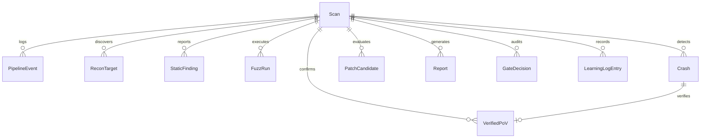

# CHAKRAVYUH — Autonomous Cyber Defense & Patch Verification System
## Comprehensive System Architecture, Pipeline & Technical Documentation

---

### Table of Contents
1. [Executive Overview & Vision](#1-executive-overview--vision)
2. [High-Level Architecture](#2-high-level-architecture)
3. [The 6-Stage Autonomous Security Pipeline](#3-the-6-stage-autonomous-security-pipeline)
   - [Stage 1: Reconnaissance & Attack Surface Mapping](#stage-1-reconnaissance--attack-surface-mapping)
   - [Stage 2: Multi-Method Bug Finding & Dynamic Fuzzing](#stage-2-multi-method-bug-finding--dynamic-fuzzing)
   - [Stage 3: Proof-of-Vulnerability (PoV) Verification & Deduplication](#stage-3-proof-of-vulnerability-pov-verification--deduplication)
   - [Stage 4: VulnDNA Historical Precedent Retrieval](#stage-4-vulndna-historical-precedent-retrieval)
   - [Stage 5: 3-Agent Patch Synthesis Arena & Adversarial Verification](#stage-5-3-agent-patch-synthesis-arena--adversarial-verification)
   - [Stage 6: Security Intelligence Report & Human Safety Gate](#stage-6-security-intelligence-report--human-safety-gate)
4. [AI / ML & LLM Engine Architecture](#4-ai--ml--llm-engine-architecture)
5. [Backend Architecture & Services](#5-backend-architecture--services)
6. [Database Schema & Data Models](#6-database-schema--data-models)
7. [Frontend Architecture & UI Modules](#7-frontend-architecture--ui-modules)
8. [API & WebSocket Event Reference](#8-api--websocket-event-reference)
9. [Configuration & Deployment](#9-configuration--deployment)

---

## 1. Executive Overview & Vision

**Chakravyuh** is an end-to-end, autonomous cyber defense platform inspired by DARPA's AI Cyber Challenge (AIxCC). It bridges the gap between automated vulnerability discovery and robust, regression-free remediation.

### Core Objectives:
- **Autonomous Discovery**: Combines AST-level semantic analysis, LLM-directed exploit generation, and coverage-guided fuzzing (AFL++) to discover memory safety vulnerabilities (CWE-122, CWE-121, CWE-416, CWE-190, etc.).
- **Deterministic Verification**: Never relies on hallucinations. Every crash candidate is replayed in an isolated AddressSanitizer (ASan) sandbox to produce an authoritative **Proof of Vulnerability (PoV)**.
- **Historical Precedent (VulnDNA)**: Leverages vector search (ChromaDB + Nomic Embeddings) over historical CVEs and proven patches (e.g., CVE-2021-3156) to guide fix synthesis.
- **Adversarial Patch Arena**: Evaluates candidate patches against **9 adversarial attack variants** and regression suites in an automated arena.
- **Human-in-the-Loop Safety Gate**: Guarantees that no autonomous patch is deployed to production without human security review and cryptographic audit trails.

---

## 2. High-Level Architecture

```
                                  +-----------------------------+
                                  |    React 18 + Vite Web UI   |
                                  |   (Real-Time Cyber Console) |
                                  +--------------+--------------+
                                                 |
                                     HTTP REST / WebSocket
                                                 |
                                  +--------------v--------------+
                                  |       FastAPI Gateway       |
                                  |    (api.main:create_app)    |
                                  +--------------+--------------+
                                                 |
                  +------------------------------+------------------------------+
                  |                              |                              |
      +-----------v-----------+      +-----------v-----------+      +-----------v-----------+
      |  PostgreSQL Database  |      |   Redis Message Broker|      |  ChromaDB Vector DB   |
      |   (SQLAlchemy ORM)    |      |  (Pub/Sub + Task Q)   |      |  (VulnDNA Embeddings) |
      +-----------------------+      +-----------+-----------+      +-----------------------+
                                                 |
                                     +-----------v-----------+
                                     |  Celery Worker Engine |
                                     |  (Pipeline Executor)  |
                                     +-----------+-----------+
                                                 |
            +------------------------------------+------------------------------------+
            |                 |                  |                  |                 |
      +-----v------+    +-----v------+     +-----v------+     +-----v------+    +-----v------+
      |  Stage 1   |    |  Stage 2   |     |  Stage 3   |     |  Stage 4   |    |  Stage 5/6 |
      |   Recon    |    | BugFinding |     |PoVVerifier |     |  VulnDNA   |    |Patch Arena |
      |AST/Semgrep |    | LLM/AFL++  |     |ASan Replay |     |Nomic/Chroma|    |Report/Gate |
      +------------+    +------------+     +------------+     +------------+    +------------+
```

---

## 3. The 6-Stage Autonomous Security Pipeline

### Stage 1: Reconnaissance & Attack Surface Mapping
- **Purpose**: Map high-risk functions, public network endpoints, tainted source paths, and dangerous memory sinks (`strcpy`, `sprintf`, `memcpy`, `malloc`).
- **Engine**: AST parsing with Clang / `pycparser` and static taint scanning with **Semgrep**.
- **Scoring**: Ranks functions with a 0–100 risk score based on caller hierarchy, user input parameters, and dangerous sink presence.

### Stage 2: Multi-Method Bug Finding & Dynamic Fuzzing
- **Purpose**: Generate proof-of-concept trigger inputs and drive coverage-guided execution.
- **Engine**: Dual-track discovery:
  1. **LLM-Directed PoC Synthesis**: Prompts local LLM (Qwen 2.5 Coder 7B via Ollama) with the disassembled target function and input formats.
  2. **AFL++ Dynamic Fuzzing**: Instrument code with ASan / Clang coverage counters and run automated mutations.

### Stage 3: Proof-of-Vulnerability (PoV) Verification & Deduplication
- **Purpose**: Authoritative verification of crash inputs in an isolated sandbox.
- **Execution**:
  - Replays inputs against ASan-compiled binary.
  - Verifies process exit codes (`134` SIGABRT, `139` SIGSEGV).
  - Normalizes stack traces (stripping compiler/runtime internal frames).
  - Computes a SHA-256 16-character deduplication hash (`stack_hash`) to merge redundant crashes.
  - Computes confidence score (0–100%) based on reproducibility and source mapping.

### Stage 4: VulnDNA Historical Precedent Retrieval
- **Purpose**: Match discovered crash signatures against historical CVE fixes.
- **Engine**: ChromaDB vector store embedded with `nomic-ai/nomic-embed-text-v1.5`.
- **Retrieval**: Queries the corpus for matching CWE, crash semantics, and function signatures. Returns matching CVE ID, similarity percentage, original flawed code, and proven fix patterns.

### Stage 5: 3-Agent Patch Synthesis Arena & Adversarial Verification
- **Purpose**: Synthesize and pit competing patch strategies against each other.
- **The 3 Agent Personas**:
  1. **Agent 1 (Root Cause Fixer)**: Traces tainted data flow; replaces unbounded sinks with explicit bounds checking and safe memory bounds.
  2. **Agent 2 (Evidence-Guided Fixer)**: Directly adapts the structural fix pattern from the top VulnDNA CVE match.
  3. **Agent 3 (Direct Surgical Fixer)**: Applies minimal surgical replacement (`snprintf`) to keep diff size minimal.
- **Adversarial Matrix (9 Variants)**:
  Every candidate is compiled in a sandbox and tested against:
  1. `original_poc`: Exact crashing input.
  2. `truncated_half`: Boundary test.
  3. `boundary_plus_one`: Single-byte off-by-one overflow.
  4. `extreme_10k_buffer`: High-volume flood payload.
  5. `null_byte_probe`: Embedded `\x00` null bytes.
  6. `ff_fill_buffer`: Signed/unsigned arithmetic 0xFF payload.
  7. `format_string_probe`: `%s%x%n` specifiers.
  8. `doubled_payload`: Concatenated repetition payload.
  9. `newline_burst`: Fast command chunks.
- **Composite Scoring Formula**:
  $$\text{Composite Score} = (\text{Security} \times 0.50) + (\text{Regression} \times 0.25) + (\text{Performance} \times 0.15) + (\text{Rediscovery} \times 0.10)$$

### Stage 6: Security Intelligence Report & Human Safety Gate
- **Purpose**: Produce CVSS v3.1 calculation, root cause summary, and enforce zero-trust patch gating.
- **Recommendation Engine**:
  - **`SAFE`**: Score $\ge 90.0$, 9/9 attacks blocked, 100% regression tests passed.
  - **`REVIEW`**: Score $60.0 - 89.9$ or slight regression/variant miss.
  - **`HOLD`**: Low score, unverified crash, or high rediscovery risk.
- **Human Gate**: Allows human security engineers to review diffs and submit `APPROVED`, `HOLD`, or `REJECTED` decisions.

---

## 4. AI / ML & LLM Engine Architecture

| Component | Technology | Role |
| :--- | :--- | :--- |
| **Local LLM** | Ollama (`qwen2.5-coder:7b`) | Context-aware PoC generation, root cause explanation, patch synthesis. |
| **Embedding Model** | `nomic-ai/nomic-embed-text-v1.5` | Dense 768-dimensional embeddings for CVE descriptions, code snippets, and crash signatures. |
| **Vector Database** | ChromaDB (`data/vulndna_db`) | Nearest neighbor semantic search over CVE-Fixes dataset with cosine similarity. |

---

## 5. Backend Architecture & Services

- **Web Framework**: FastAPI (Asynchronous Python 3.12).
- **Task Queue**: Celery with Redis broker (`redis://localhost:6379/0`).
- **Real-Time Streaming**: WebSocket channels at `/api/scans/{scan_id}/stream` with JSON event payloads (`log`, `stage_started`, `stage_completed`, `scan_complete`, `gate_decision`).
- **Sandbox Isolation**: Subprocess & Docker runner with resource capping and timeout monitors.

---

## 6. Database Schema & Data Models

Managed via SQLAlchemy ORM with PostgreSQL:



---

## 7. Frontend Architecture & UI Modules

Built with React 18, Vite, TailwindCSS, and Lucide React icons.

| Page / Screen | Path | Key Capabilities |
| :--- | :--- | :--- |
| **Dashboard** | `/dashboard` | System status, live scans table, pipeline stage indicators, quick metrics. |
| **Upload Target** | `/upload` | Drag-and-drop zip/source files, language detection, target queueing. |
| **Recon Engine** | `/recon` | Interactive attack surface tree, ranked target functions, risk scores. |
| **Bug Finding** | `/findings` | AFL++ live execution graphs, exec/sec stats, discovered crash tables. |
| **PoV Verifier** | `/pov` | Live ASan sanitizer stderr viewer, stack trace inspector, deduplication hash chips. |
| **VulnDNA** | `/vulndna` | Precedent similarity cards, CVE comparisons, vector search query inspector. |
| **Patch Engine** | `/patches` | 3-agent arena comparison, side-by-side diff viewers, 9-variant attack test matrix. |
| **Security Report** | `/report` | Executive summary, CVSS badge, interactive Human Safety Gate decision modal. |
| **Learning Log** | `/learning` | Historical knowledge base of tested targets, winning agents, and fix patterns. |

---

## 8. API & WebSocket Event Reference

### Core Endpoints:
- `POST /api/scans/upload` — Upload archive or source files.
- `GET /api/scans` — List all scan records.
- `GET /api/scans/{scan_id}` — Get scan details and execution stage.
- `GET /api/scans/{scan_id}/recon` — Target functions and static findings.
- `GET /api/scans/{scan_id}/findings` — Fuzz metrics and crash candidates.
- `GET /api/scans/{scan_id}/povs` — Verified PoVs with stack traces.
- `GET /api/scans/{scan_id}/vulndna` — Top matching historical CVEs.
- `GET /api/scans/{scan_id}/patches` — Patch candidates, scores, and selected winner.
- `GET /api/scans/{scan_id}/report` — Security report and recommendation.
- `POST /api/scans/{scan_id}/gate` — Submit human safety gate decision.
- `WS /api/scans/{scan_id}/stream` — WebSocket event stream.

---

## 9. Configuration & Deployment

### Quick Start:

1. **Environment Configuration**:
   ```bash
   cp backend/.env.example backend/.env
   ```

2. **Start Backend Infrastructure**:
   ```bash
   # Start Redis & PostgreSQL
   docker run -d -p 5432:5432 -e POSTGRES_USER=chakravyuh -e POSTGRES_PASSWORD=password -e POSTGRES_DB=chakravyuh postgres:16
   docker run -d -p 6379:6379 redis:7-alpine
   ```

3. **Start Workers & API**:
   ```bash
   # Celery Worker
   cd backend && celery -A workers.celery_app worker --loglevel=info -c 2

   # FastAPI Server
   cd backend && uvicorn api.main:app --host 0.0.0.0 --port 8000 --reload
   ```

4. **Start Frontend Web Console**:
   ```bash
   cd frontend && npm install && npm run dev
   ```
